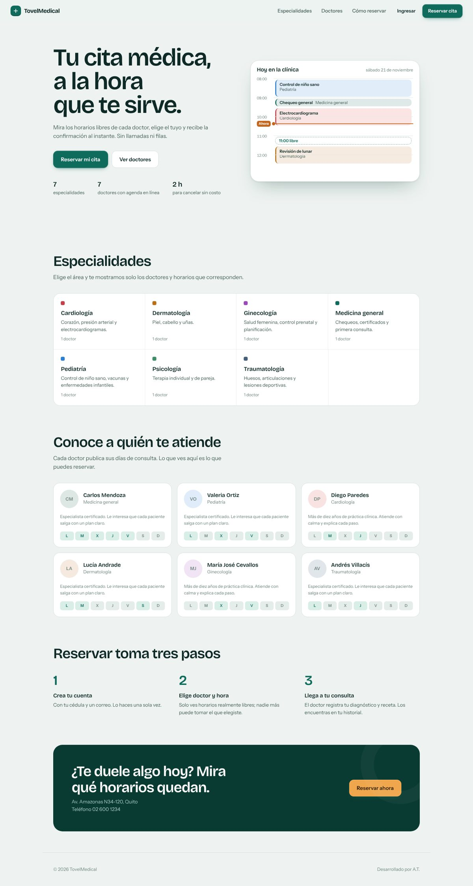
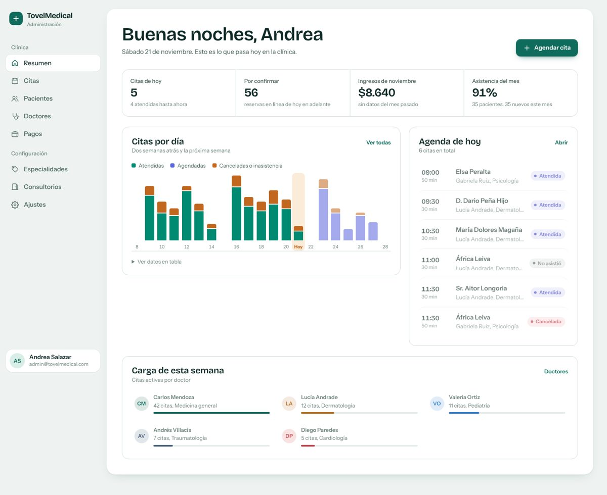
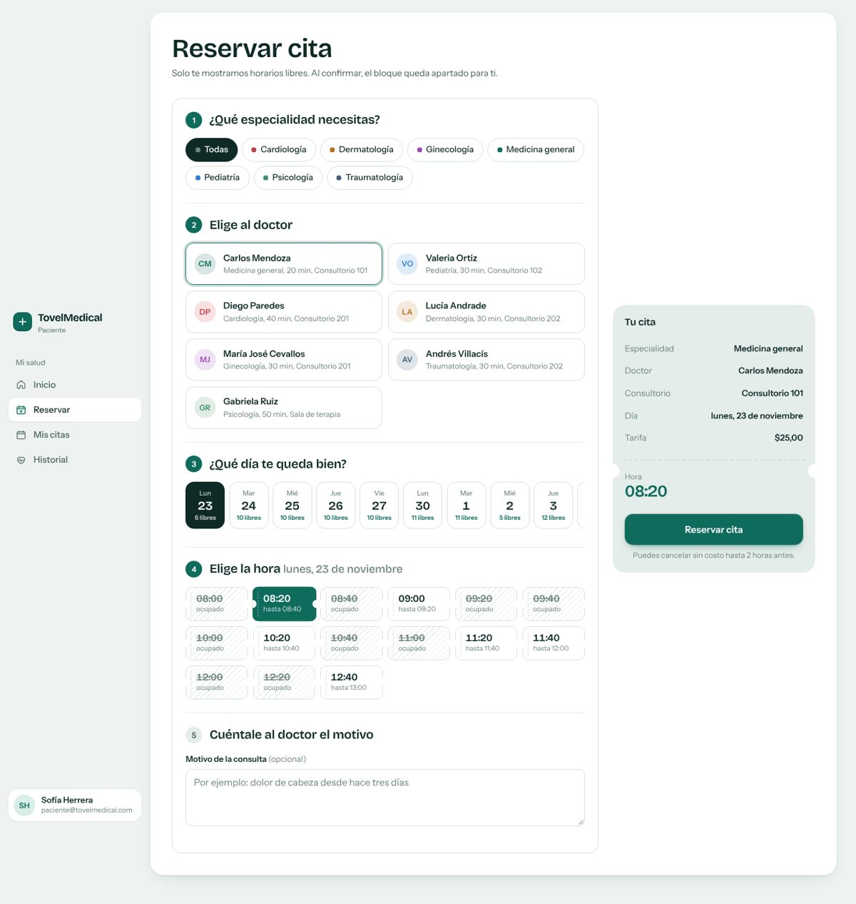
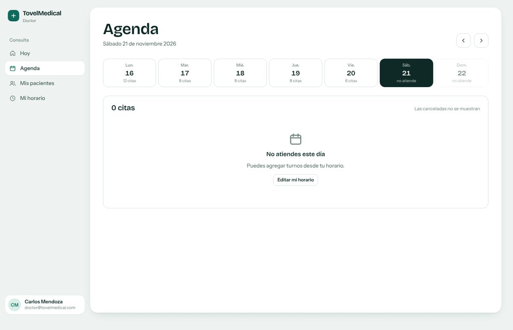
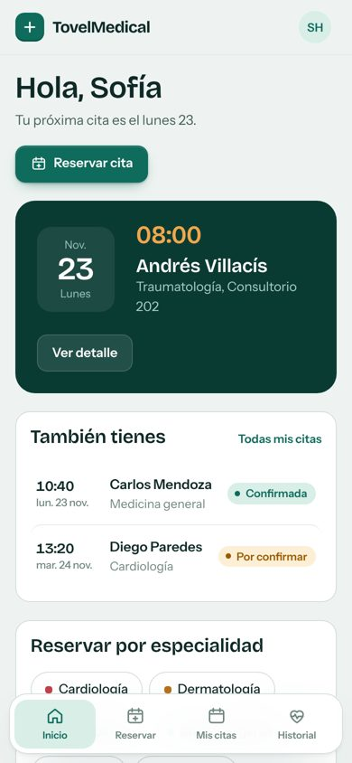

# TovelMedical

Reserva de citas médicas en línea para clínicas y consultorios. Tres perfiles con su propio panel:

- **Administración**: agenda de la clínica, doctores y sus turnos, pacientes, especialidades, consultorios, pagos, reportes y ajustes.
- **Doctor**: agenda del día y de la semana, atención de consultas (signos vitales, diagnóstico, receta), historial de sus pacientes y su propio horario.
- **Paciente**: reserva guiada en cinco pasos, sus citas (con cancelación), historial clínico y recetas en PDF.

**Demo navegable con recorrido guiado (datos ficticios):** [anderssont-var.github.io/AnderssonT-var.github/demos/tovelmedical/](https://anderssont-var.github.io/AnderssonT-var.github/demos/tovelmedical/)



| Administración | Reserva del paciente |
|---|---|
|  |  |

| Agenda del doctor | Paciente en el celular |
|---|---|
|  |  |

_Capturas con datos de prueba._

## Cómo funciona la agenda

Toda la lógica de reservas vive en `app/Services/AgendaService.php`:

- Los bloques salen de los turnos semanales del doctor y de la duración de su cita (por ejemplo, 08:00–12:00 en bloques de 20 min).
- Un bloque está libre si no se cruza con una cita activa, si está dentro del rango permitido (`dias_reserva`) y si falta al menos 30 minutos para que empiece.
- **Sin dobles reservas**: cada reserva bloquea la fila del doctor dentro de una transacción y además hay un índice único (`doctor_id, fecha, hora_inicio, bloque_activo`). Al cancelar, `bloque_activo` pasa a `NULL` y el horario se puede volver a tomar.
- Un paciente no puede tener dos citas a la misma hora ni dos citas el mismo día con el mismo doctor.
- El paciente cancela hasta `horas_cancelacion` antes (configurable en Ajustes). El doctor y la administración pueden cancelar en cualquier momento.
- Estados: por confirmar, confirmada, atendida, cancelada y no asistió. Al guardar la consulta, la cita queda como atendida.
- La cédula se valida con el dígito verificador ecuatoriano.

Los permisos se controlan con el middleware `rol:` por sección y con `CitaPolicy` / `ConsultaPolicy` por registro: un paciente solo ve lo suyo y un doctor solo el historial de pacientes que ha atendido.

## Diseño

Interfaz propia, sin plantillas de administración: tipografía Bricolage Grotesque e Instrument Sans, paleta verde pino con acento yodo para lo que pasa "ahora" y bloques de hora con forma de ticket. Incluye modo claro y oscuro (sigue al sistema; se puede fijar desde el perfil), transiciones entre páginas con View Transitions, diálogos nativos `<dialog>`, avisos con `popover`, barra de pestañas en el celular y respeto por `prefers-reduced-motion`. Los colores del gráfico están validados para daltonismo.

## Tecnologías

Laravel 11 · PHP 8.2+ · MySQL o SQLite · Blade · Vite · CSS moderno sin framework · JavaScript sin dependencias · DomPDF

## Ejecutar en local

```bash
composer install
npm install
cp .env.example .env
php artisan key:generate
touch database/database.sqlite   # o configura MySQL en .env
php artisan migrate --seed
npm run build
php artisan serve
```

Cuentas de prueba (contraseña `password`):

| Perfil | Correo |
|---|---|
| Administración | admin@tovelmedical.com |
| Doctor | doctor@tovelmedical.com |
| Paciente | paciente@tovelmedical.com |

Con `APP_DEMO=true` el login muestra estas cuentas para entrar con un clic. Desactívalo en producción.

## Pruebas

```bash
php artisan test
```

Cubren la generación de bloques, la anticipación mínima, las dobles reservas, los cruces de horario del paciente y del doctor, la regla de cancelación, el acceso por rol y el flujo completo de reservar y atender.

## Producción (Hostinger u otro hosting)

1. `composer install --no-dev --optimize-autoloader` y `npm run build`.
2. Configura en `.env`: `APP_ENV=production`, `APP_DEBUG=false`, `APP_DEMO=false`, `APP_URL` y la conexión MySQL.
3. `php artisan migrate --force`, luego crea el primer administrador con `php artisan tinker` o ejecuta el seeder solo en un entorno de prueba.
4. `php artisan config:cache route:cache view:cache`.

---
Desarrollado por A.T.
