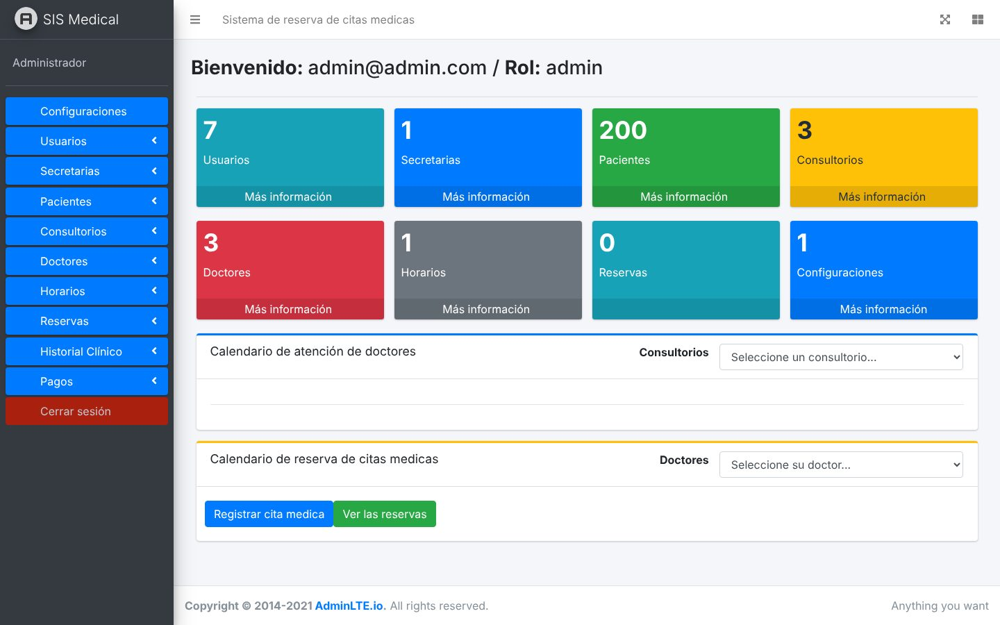
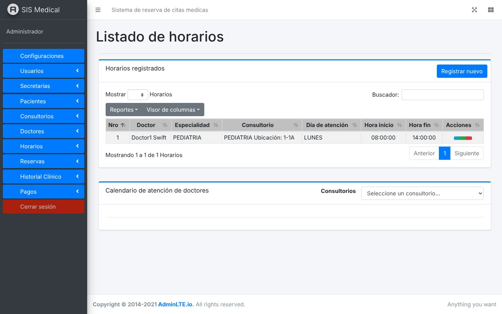
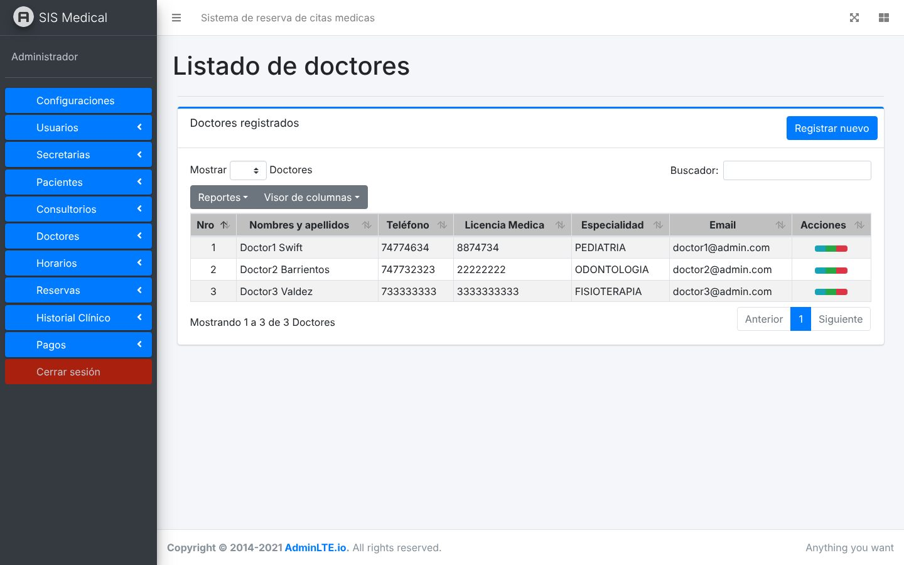

# Sistema de reserva de citas médicas

Aplicación web para clínicas y consultorios: los pacientes reservan citas en línea y el personal administra toda la operación desde un panel.


## Capturas

**Panel del administrador**



**Horarios de atención por doctor y consultorio**



**Gestión de doctores**



_Capturas tomadas con datos de prueba._

## Funciones

- Calendario de reservas por consultorio y doctor
- Gestión de doctores, pacientes, secretarias, consultorios y horarios
- Historial clínico por paciente, con búsqueda y exportación a PDF
- Registro de pagos
- Reportes de doctores en PDF
- Roles y permisos de usuario (Spatie Laravel Permission)

## Tecnologías

Laravel · PHP · MySQL · Blade · AdminLTE · FullCalendar · JavaScript

## Ejecutar en local

```bash
composer install
npm install
cp .env.example .env
php artisan key:generate
php artisan migrate --seed
php artisan serve
```

Configura la conexión a la base de datos en `.env` antes de ejecutar las migraciones.

---
Desarrollado por [Andersson Toapanta](https://anderssont-var.github.io/AnderssonT-var.github/)
